<div align="center">


<br>


**Matrícula 2025-0697** · Red `20.25.6.0/24`

</div>

---

## 🎬 Video demostrativo

<div align="center">

[]((https://www.youtube.com/watch?v=EYMC0ZAujWE))

</div>


---

## 📑 Índice

1. [Propósito y objetivos](#-propósito-y-objetivos)
2. [Entorno del laboratorio](#-entorno-del-laboratorio)
3. [Topología](#-topología)
4. [Plan de direccionamiento](#-plan-de-direccionamiento)
5. [Direccionamiento IP del router y los switches](#-direccionamiento-ip-del-router-y-los-switches)
6. [Servidor DHCP para la LAN](#-servidor-dhcp-para-la-lan)
7. [Comunidad SNMP de solo lectura](#-comunidad-snmp-de-solo-lectura)
8. [Zabbix: instalación](#-zabbix-instalación)
9. [Zabbix como cliente DHCP](#-zabbix-como-cliente-dhcp)
10. [Agregar el router y los switches a Zabbix](#-agregar-el-router-y-los-switches-a-zabbix)
11. [Verificación de datos SNMP en Zabbix](#-verificación-de-datos-snmp-en-zabbix)
12. [Resultado frente a los requisitos](#-resultado-frente-a-los-requisitos)
13. [Scripts](#-scripts)
14. [Running-configs](#-running-configs)
15. [Estructura del repositorio](#-estructura-del-repositorio)

---

## 🎯 Propósito y objetivos

Montar una LAN virtual donde un **router Cisco** entrega direcciones por **DHCP**, el router y dos **switches** exponen datos por **SNMP v2c de solo lectura**, y un **servidor Zabbix** (cliente DHCP) los consulta para **verificar los datos SNMP**.

| # | Objetivo | Estado |
|---|----------|:------:|
| 1 | Direccionamiento IP en router y switches | ✅ |
| 2 | Servidor DHCP para la red LAN | ✅ |
| 3 | Comunidad SNMP de solo lectura | ✅ |
| 4 | Servidor Zabbix como cliente DHCP | ✅ |
| 5 | Verificar en Zabbix los datos SNMP del router y los switches | ✅ |
| 6 | Documentación con imágenes, diagramas, scripts y running-configs | ✅ |
| 7 | Video demostrativo | ✅ |

Detalle ampliado: [`docs/01-proposito-y-objetivos.md`](docs/01-proposito-y-objetivos.md).

---

## 🗺️ Topología

### Captura de GNS3

<div align="center">
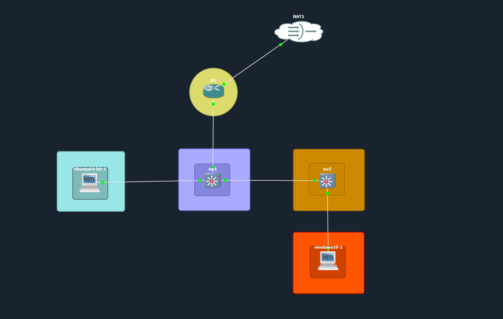
</div>

**Qué demuestra:** la conexión `NAT1 — R1 — SW1`, con el servidor Ubuntu colgando de SW1 y `SW1 — SW2 — Windows 10`.

### Diagrama lógico

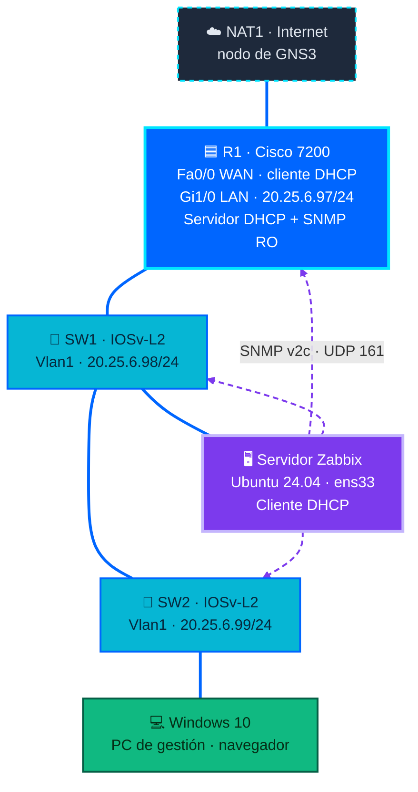

> Las líneas **continuas** son enlaces de la red; las **punteadas moradas** son consultas SNMP (lógicas). Los números de puerto entre equipos **no están documentados** (falta `show cdp neighbors`).

---

## 🧮 Plan de direccionamiento

El esquema parte de la matrícula **2025-0697**: `20.25` (año) · `.6` (de 06) · `.97` (router).

| Equipo | Interfaz | Dirección | Asignación |
|---|---|---|---|
| **R1** | Gi1/0 (LAN) | `20.25.6.97/24` | 🔵 Estática |
| **R1** | Fa0/0 (WAN → NAT1) | Obtenida por DHCP | 🟣 Dinámica |
| **SW1** | Vlan1 | `20.25.6.98/24` | 🔵 Estática |
| **SW2** | Vlan1 | `20.25.6.99/24` | 🔵 Estática |
| **Servidor Zabbix** | ens33 | Pool DHCP (`.100` a `.254`) | 🟣 Dinámica |

Detalle y criterio de diseño: [`docs/02-plan-de-direccionamiento.md`](docs/02-plan-de-direccionamiento.md).

---

## 🌐 Direccionamiento IP del router y los switches

**Configuración en R1** (extraída de su running-config):

```text
interface FastEthernet0/0
 description WAN-INTERNET
 ip address dhcp
 ip nat outside
!
interface GigabitEthernet1/0
 description LAN-2025-0697
 ip address 20.25.6.97 255.255.255.0
 ip nat inside
```

**Configuración en los switches** (SW1 se muestra; SW2 usa `20.25.6.99`):

```text
interface Vlan1
 ip address 20.25.6.98 255.255.255.0
!
ip default-gateway 20.25.6.97
```

### Evidencias

<table>
<tr>
<td width="50%" align="center"><b>R1 · <code>show ip interface brief</code></b><br>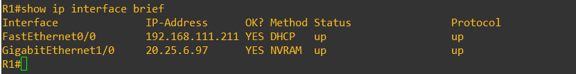</td>
<td width="50%" align="center"><b>SW1 · <code>show ip interface brief</code></b><br>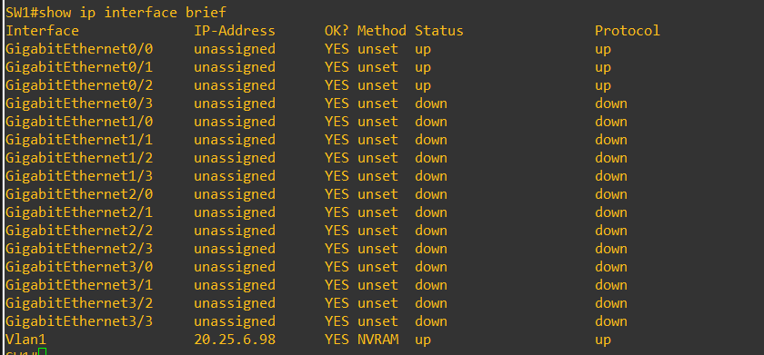</td>
</tr>
<tr>
<td valign="top">Demuestra <code>Gi1/0 = 20.25.6.97</code> (<i>up/up</i>, origen NVRAM) y <code>Fa0/0</code> con IP obtenida por DHCP (<code>192.168.111.211</code> en el momento de la captura).</td>
<td valign="top">Demuestra <code>Vlan1 = 20.25.6.98</code> (<i>up/up</i>). Tres interfaces físicas activas: <code>Gi0/0</code>, <code>Gi0/1</code> y <code>Gi0/2</code>.</td>
</tr>
<tr>
<td align="center"><b>SW2 · <code>show ip interface brief</code></b><br>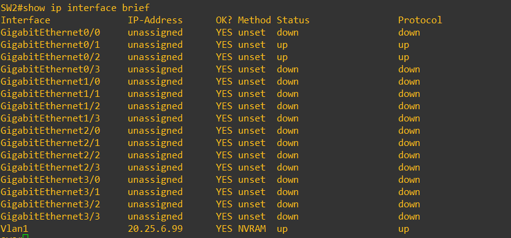</td>
<td align="center"><b>R1 · pings a la LAN</b><br>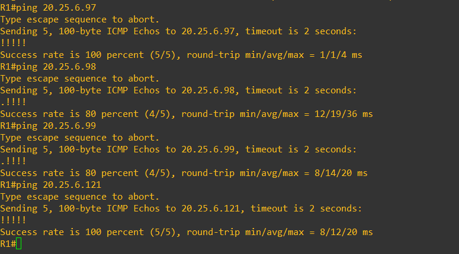</td>
</tr>
<tr>
<td valign="top">Demuestra <code>Vlan1 = 20.25.6.99</code> (<i>up/up</i>). Interfaces activas: <code>Gi0/1</code> y <code>Gi0/2</code>.</td>
<td valign="top">R1 → <code>.97</code> 100 %, <code>.98</code> 80 %, <code>.99</code> 80 % y <code>.121</code> 100 %. En <code>.98</code> y <code>.99</code> se perdió el primer paquete; una repetición de 10 pings a SW1 dio 10/10 (ver captura de <a href="screenshots/09-troubleshooting/10-binding-conflicto-ip-102.png">troubleshooting</a>).</td>
</tr>
</table>

<div align="center">
<b>Servidor Zabbix → R1, SW1 y SW2</b><br>
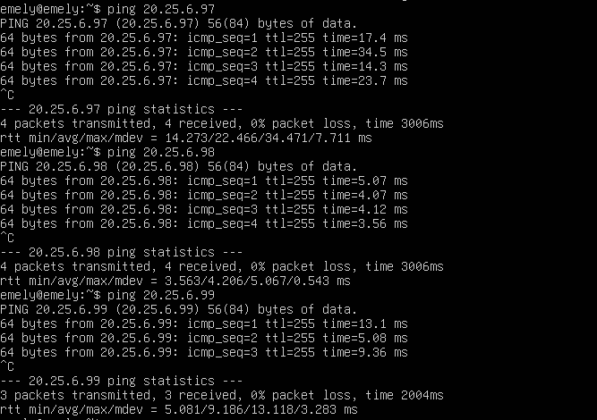
</div>

**Qué demuestra:** conectividad del servidor con los tres equipos de red: 0 % de pérdida hacia `20.25.6.97` (4/4), `.98` (4/4) y `.99` (3/3, interrumpido con Ctrl+C).

---

## 📬 Servidor DHCP para la LAN

R1 entrega direcciones en la LAN con el pool **`LAN-0697`**.

```text
ip dhcp excluded-address 20.25.6.1 20.25.6.99
!
ip dhcp pool LAN-0697
 network 20.25.6.0 255.255.255.0
 default-router 20.25.6.97
 dns-server 8.8.8.8
 lease 7
```

| Parámetro | Valor |
|---|---|
| Red | `20.25.6.0/24` |
| Excluidas | `.1` a `.99` (99 direcciones) |
| Rango asignable | `.100` a `.254` *(deducido de la exclusión)* |
| Gateway / DNS | `20.25.6.97` / `8.8.8.8` |
| Concesión | 7 días |

### Proceso DHCP (DORA)

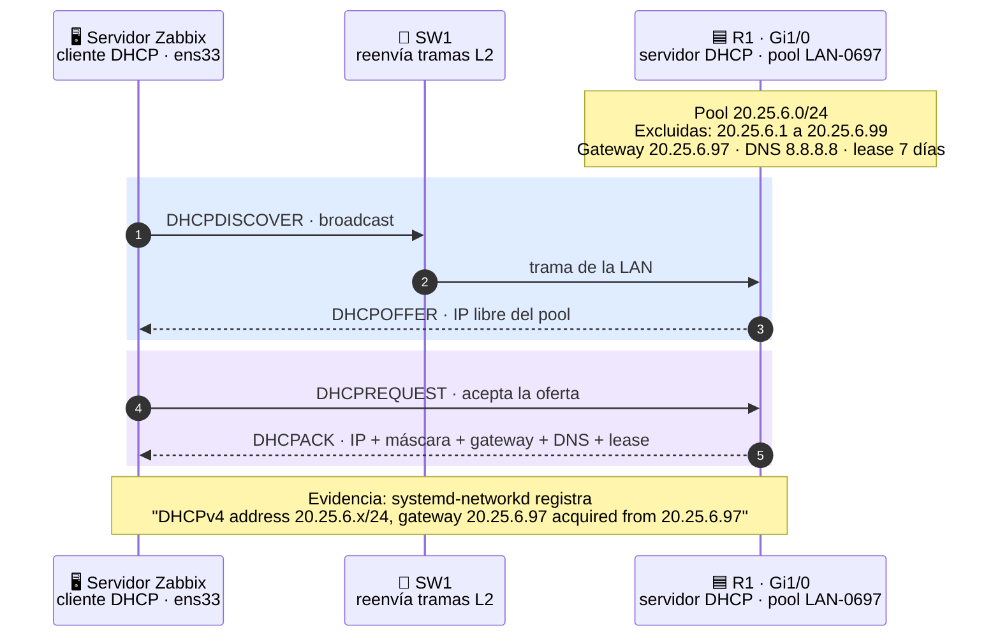

### Evidencias

<table>
<tr>
<td width="50%" align="center"><b>Pool inicial</b><br>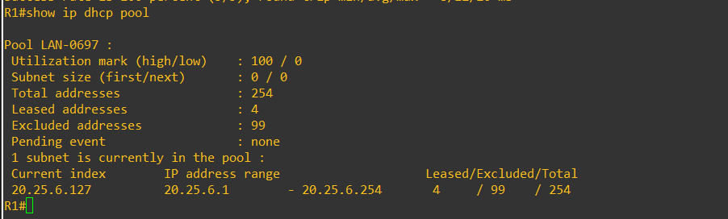</td>
<td width="50%" align="center"><b>Bindings iniciales</b><br>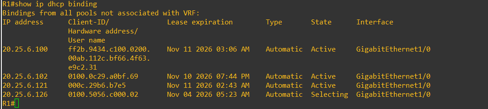</td>
</tr>
<tr>
<td valign="top">Pool <code>LAN-0697</code>: 254 direcciones totales, <b>99 excluidas</b>, 4 concedidas; rango <code>20.25.6.1 – 20.25.6.254</code>.</td>
<td valign="top">Cuatro concesiones, todas por <code>Gi1/0</code>: <code>.100</code>, <code>.102</code>, <code>.121</code> (MAC <code>000c.29b6.b7e5</code>, el servidor) y <code>.126</code> (estado <i>Selecting</i>).</td>
</tr>
</table>

<div align="center">
<b>Estado final: binding, conflictos y pool</b><br>
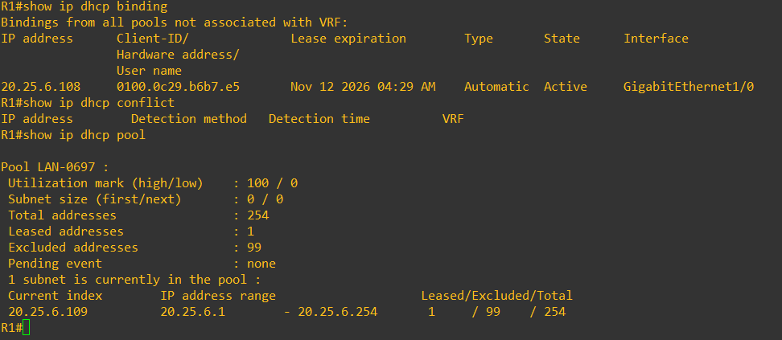
</div>

**Qué demuestra:** R1 asignó `20.25.6.108` al servidor (Client-ID `0100.0c29.b6b7.e5`, es decir, `01` + su MAC), concesión hasta el **12-nov-2026 04:29 AM**, estado *Active*. `show ip dhcp conflict` aparece **vacío** y el pool muestra 1 concesión y 99 excluidas.

---

## 🔍 Comunidad SNMP de solo lectura

```text
snmp-server community lectura0697 RO
snmp-server location Lab-Santo-Domingo
snmp-server contact Matricula-2025-0697      ! solo en R1
```

> `RO` = *read-only*. La comunidad permite **consultar** pero no **modificar**. `lectura0697` es un valor de laboratorio.

### Prueba de lectura y escritura

<table>
<tr>
<td width="50%" align="center"><b>✅ Lectura · <code>snmpget</code></b><br>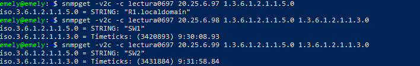</td>
<td width="50%" align="center"><b>⛔ Escritura · <code>snmpset</code></b><br>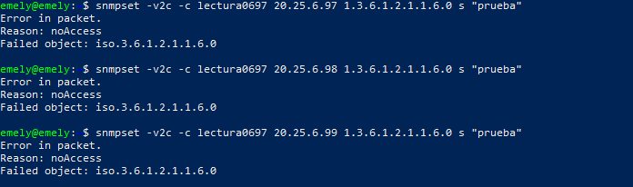</td>
</tr>
<tr>
<td valign="top">Los tres equipos responden: R1 con <code>sysName = "R1.localdomain"</code>; SW1 con <code>"SW1"</code> y uptime <code>9:30:08.93</code>; SW2 con <code>"SW2"</code> y uptime <code>9:31:58.84</code>.</td>
<td valign="top">Los tres equipos rechazan la escritura de <code>sysLocation</code> (<code>1.3.6.1.2.1.1.6.0</code>) con <b><code>Reason: noAccess</code></b>. Confirma que la comunidad es de solo lectura.</td>
</tr>
</table>

---

## 🧩 Zabbix: instalación

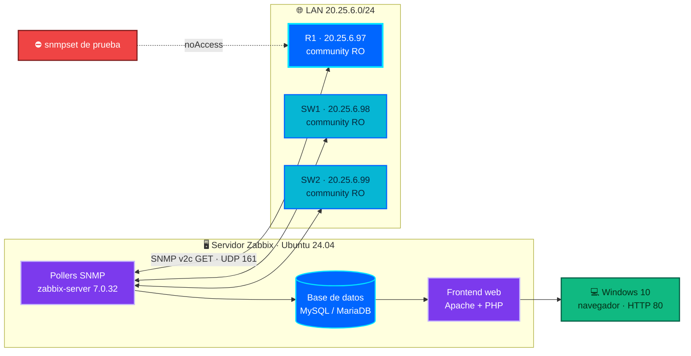

Scripts: [`01_instalar_zabbix.sh`](scripts/01_instalar_zabbix.sh) y [`02_configurar_bd_zabbix.sh`](scripts/02_configurar_bd_zabbix.sh). Procedimiento: [`docs/03-procedimiento-zabbix.md`](docs/03-procedimiento-zabbix.md).

### Asistente web

<table>
<tr>
<td width="33%" align="center"><b>1 · Bienvenida</b><br>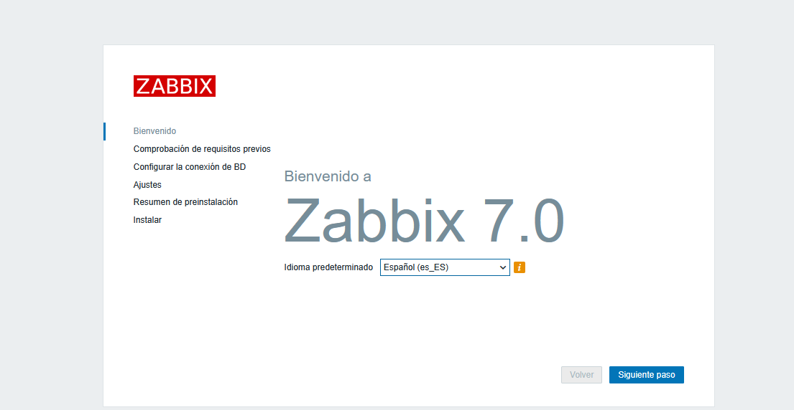</td>
<td width="33%" align="center"><b>2 · Conexión de BD</b><br>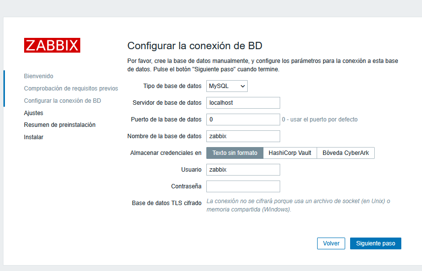</td>
<td width="33%" align="center"><b>3 · Ajustes</b><br>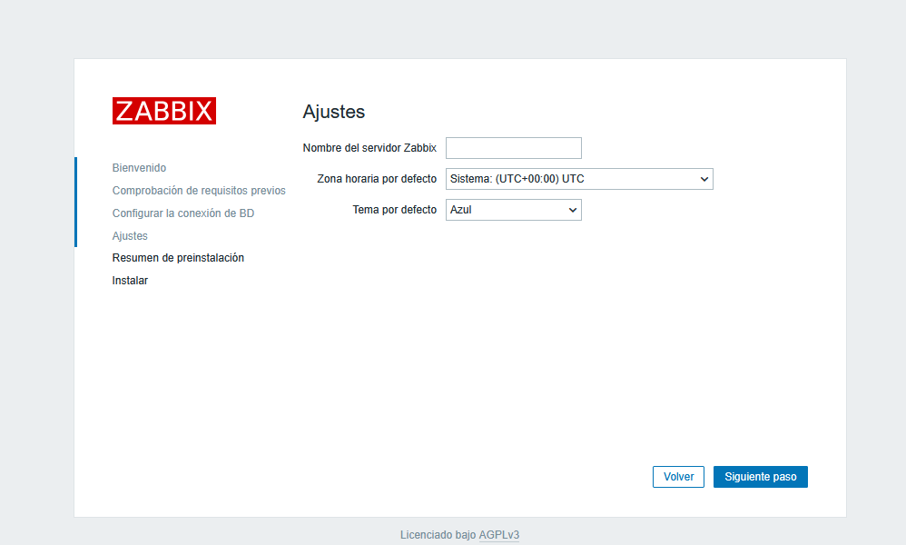</td>
</tr>
<tr>
<td valign="top">Pantalla inicial de <b>Zabbix 7.0</b>, idioma Español.</td>
<td valign="top">Tipo MySQL, servidor <code>localhost</code>, base <code>zabbix</code>, usuario <code>zabbix</code> (campo de contraseña en blanco en la captura).</td>
<td valign="top">Nombre del servidor, zona horaria y tema. En la captura aún están sin completar.</td>
</tr>
</table>

### Servicio y Dashboard

<table>
<tr>
<td width="50%" align="center"><b><code>systemctl status zabbix-server</code></b><br>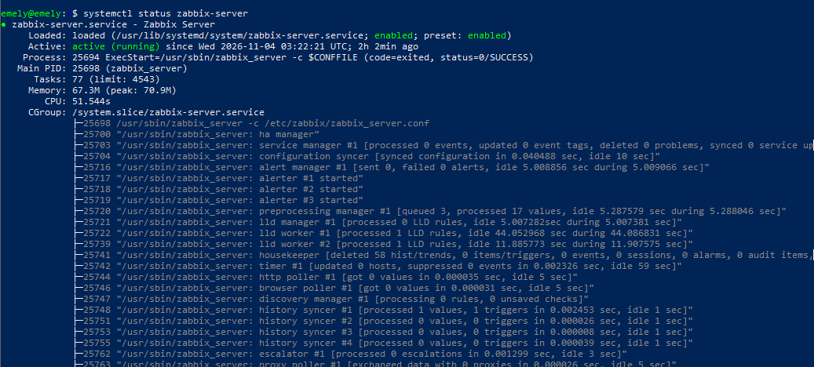</td>
<td width="50%" align="center"><b>Dashboard</b><br>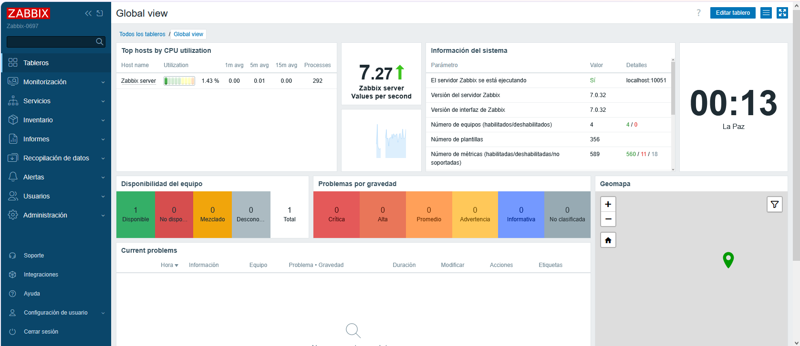</td>
</tr>
<tr>
<td valign="top">Servicio <b><i>active (running)</i></b> y <i>enabled</i>, iniciado el <code>2026-11-04 03:22:21 UTC</code>, con sus procesos (pollers, history syncers, etc.).</td>
<td valign="top"><b>"El servidor Zabbix se está ejecutando: Sí"</b> (<code>localhost:10051</code>), versión <b>7.0.32</b> y <b>4 equipos habilitados / 0 deshabilitados</b>.</td>
</tr>
</table>

---

## 🖧 Zabbix como cliente DHCP

El servidor obtiene su IP de R1 mediante DHCP. Archivo `/etc/netplan/50-cloud-init.yaml`:

```yaml
network:
  version: 2
  ethernets:
    ens33:
      dhcp4: true
      dhcp-identifier: mac
```

<div align="center">
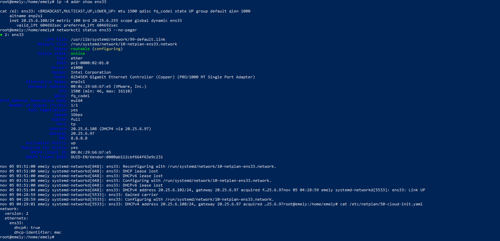
</div>

**Qué demuestra** (captura final):

| Evidencia | Valor observado |
|---|---|
| `ip -4 addr show ens33` | `20.25.6.108/24` · *dynamic* |
| `networkctl status ens33` | *Address* `20.25.6.108 (DHCP4 via 20.25.6.97)` · *Gateway* `20.25.6.97` · *DNS* `8.8.8.8` · *Online state* `online` |
| Registro de `systemd-networkd` | `DHCPv4 address 20.25.6.108/24, gateway 20.25.6.97 acquired` |
| Netplan | `dhcp4: true` y `dhcp-identifier: mac` |
| R1 (`show ip dhcp binding`) | `20.25.6.108` con Client-ID `0100.0c29.b6b7.e5` (ver [sección DHCP](#-servidor-dhcp-para-la-lan)) |

Script: [`03_configurar_cliente_dhcp.sh`](scripts/03_configurar_cliente_dhcp.sh) · Evidencias: [`05_evidencias_cliente_dhcp.sh`](scripts/05_evidencias_cliente_dhcp.sh).

> ℹ️ La IP del servidor cambió durante las pruebas (`.121`, `.100`, `.102`, `.108`). Es esperado en un cliente DHCP; el historial y sus causas están en [`docs/04-troubleshooting.md`](docs/04-troubleshooting.md).

---

## ➕ Agregar el router y los switches a Zabbix

Ruta: **Recopilación de datos → Equipos → Crear equipo**.

| Campo | R1 | SW1 | SW2 |
|---|---|---|---|
| Nombre del equipo | `R1` | `SW1` | `SW2` |
| Plantilla | Cisco IOS by SNMP | Cisco IOS by SNMP | Cisco IOS by SNMP |
| Interfaz SNMP | `20.25.6.97` : `161` | `20.25.6.98` : `161` | `20.25.6.99` : `161` |
| Versión SNMP | SNMPv2 | SNMPv2 | SNMPv2 |
| Comunidad | `{$SNMP_COMMUNITY}` | `{$SNMP_COMMUNITY}` | `{$SNMP_COMMUNITY}` |
| Macro `{$SNMP_COMMUNITY}` | comunidad de solo lectura del laboratorio | ← igual | ← igual |

> ⚠️ **Falta la captura del formulario *Crear equipo*.** Plantilla, IP y puerto están comprobados en la lista de equipos (abajo); la versión SNMP y el macro siguen el procedimiento aplicado.

<div align="center">
<b>Lista de equipos en Zabbix</b><br>
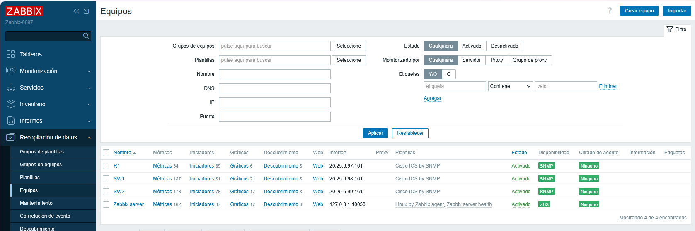
</div>

**Qué demuestra:**

| Equipo | Interfaz | Plantilla | Disponibilidad |
|---|---|---|---|
| R1 | `20.25.6.97:161` | Cisco IOS by SNMP | 🟩 **SNMP** |
| SW1 | `20.25.6.98:161` | Cisco IOS by SNMP | 🟩 **SNMP** |
| SW2 | `20.25.6.99:161` | Cisco IOS by SNMP | 🟩 **SNMP** |
| Zabbix server | `127.0.0.1:10050` | Linux by Zabbix agent · Zabbix server health | 🟩 **ZBX** |

<details>
<summary>📷 Captura alterna de la misma lista (con aviso de Firefox superpuesto)</summary>

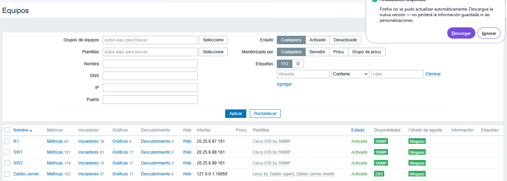

</details>

---

## ✅ Verificación de datos SNMP en Zabbix

Ruta: **Monitorización → Últimos datos**, filtrando por **Equipos**.

### Datos básicos del sistema (filtro `System`)

<table>
<tr>
<td width="33%" align="center"><b>R1</b><br>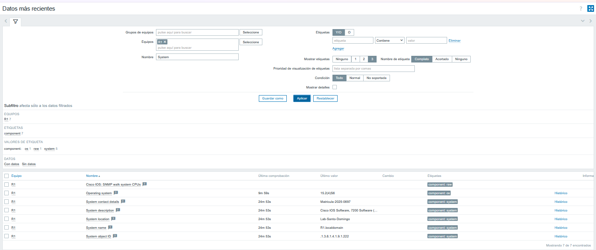</td>
<td width="33%" align="center"><b>SW1</b><br>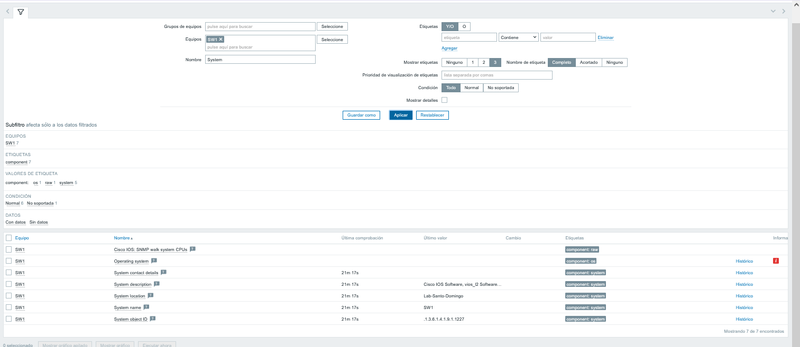</td>
<td width="33%" align="center"><b>SW2</b><br>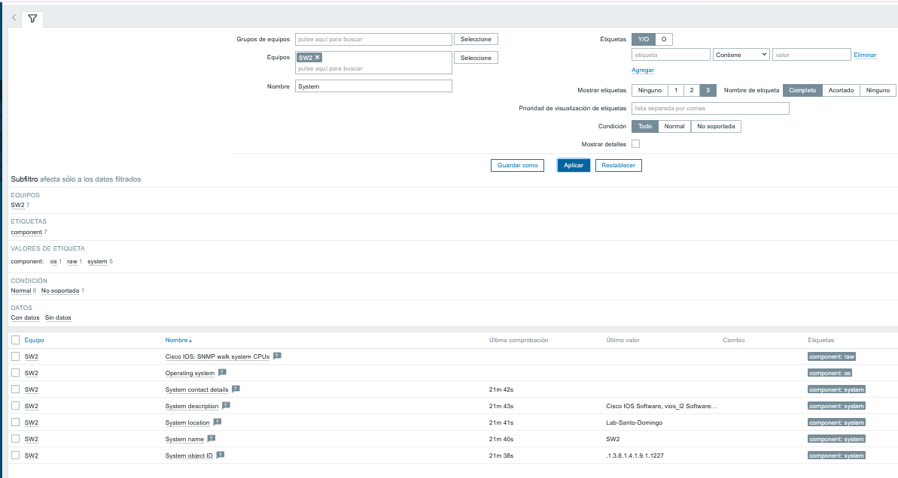</td>
</tr>
</table>

| Elemento en Zabbix | R1 | SW1 | SW2 |
|---|---|---|---|
| System name | `R1.localdomain` | `SW1` | `SW2` |
| System location | `Lab-Santo-Domingo` | `Lab-Santo-Domingo` | `Lab-Santo-Domingo` |
| System contact details | `Matricula-2025-0697` | *(vacío)* | *(vacío)* |
| System object ID | `.1.3.6.1.4.1.9.1.222` | `.1.3.6.1.4.1.9.1.1227` | `.1.3.6.1.4.1.9.1.1227` |
| System description | Cisco IOS Software, 7200 Software… | Cisco IOS Software, vios_l2 Software… | Cisco IOS Software, vios_l2 Software… |
| Operating system | `15.2(4)S6` | sin valor | sin valor |

**Coincidencia con la terminal:** el nombre del sistema que muestra Zabbix (`R1.localdomain`, `SW1`, `SW2`) es el mismo que devolvió `snmpget` ([ver evidencia](#-comunidad-snmp-de-solo-lectura)). La ubicación y el contacto coinciden con el running-config.

### Todos los elementos recolectados

<table>
<tr>
<td width="33%" align="center"><b>R1</b><br>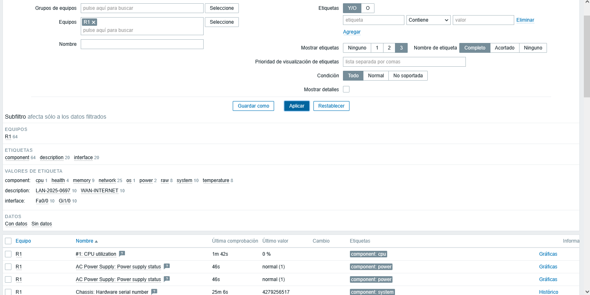</td>
<td width="33%" align="center"><b>SW1</b><br>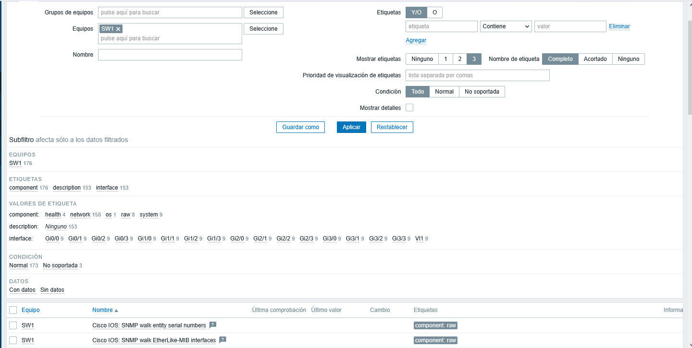</td>
<td width="33%" align="center"><b>SW2</b><br>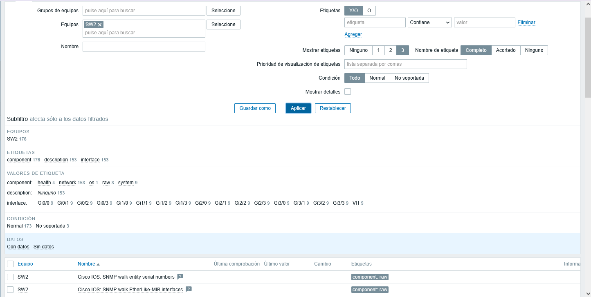</td>
</tr>
<tr>
<td valign="top">Elementos con valores reales: <i>CPU utilization</i> 0 %, fuentes de poder <code>normal (1)</code>, número de serie del chasis y las interfaces <code>Fa0/0</code> (<code>LAN-2025-0697</code> / <code>WAN-INTERNET</code> en las etiquetas) y <code>Gi1/0</code>.</td>
<td valign="top">Zabbix descubrió las interfaces <code>Gi0/0</code> a <code>Gi3/3</code> y <code>Vl1</code>.</td>
<td valign="top">Mismo conjunto de interfaces que SW1 (<code>Gi0/0</code> a <code>Gi3/3</code> y <code>Vl1</code>).</td>
</tr>
</table>

> Los elementos *"Cisco IOS: SNMP walk …"* no muestran valor: son elementos maestros que recolectan en bloque para los demás.

---

## 📋 Resultado frente a los requisitos

### Router y switches

| Requisito | Evidencia | Estado |
|---|---|:---:|
| Direccionamiento IP | `show ip interface brief` de R1, SW1 y SW2; pings; running-configs | ✅ |
| Servidor DHCP para la LAN | Pool `LAN-0697`, bindings, running-config de R1 | ✅ |
| Comunidad SNMP de solo lectura | `snmpget` correcto, `snmpset` con `noAccess`, running-configs | ✅ |

### Servidor Zabbix

| Requisito | Evidencia | Estado |
|---|---|:---:|
| Cliente DHCP | `ip -4 addr`, `networkctl`, netplan y binding en R1 (`20.25.6.108`) | ✅ |
| Verificar datos SNMP del router y los switches | Lista de equipos con SNMP verde y *Últimos datos* | ✅ |

### Repositorio

| Requisito | Estado |
|---|:---:|
| Repositorio de GitHub organizado | ✅ |
| Documentación profesional | ✅ |
| 🎬 Video al inicio del repositorio | ⏳ marcador listo, falta el video |
| Imágenes en la documentación | ✅ |
| Diagramas | ✅ |
| Propósito del laboratorio | ✅ |
| Scripts utilizados | ✅ |
| Running-configs | ✅ |

---

## 💻 Scripts

| Script | Función |
|---|---|
| [`01_instalar_zabbix.sh`](scripts/01_instalar_zabbix.sh) | Agrega el repositorio de Zabbix 7.0 e instala los paquetes |
| [`02_configurar_bd_zabbix.sh`](scripts/02_configurar_bd_zabbix.sh) | Crea la base, importa el esquema, fija `DBPassword` y arranca servicios |
| [`03_configurar_cliente_dhcp.sh`](scripts/03_configurar_cliente_dhcp.sh) | Deja `ens33` como cliente DHCP identificado por MAC |
| [`04_verificar_snmp.sh`](scripts/04_verificar_snmp.sh) | Prueba `snmpget` (debe funcionar) y `snmpset` (debe fallar) |
| [`05_evidencias_cliente_dhcp.sh`](scripts/05_evidencias_cliente_dhcp.sh) | Recolecta la evidencia del cliente DHCP |
| [`cisco/r1-config.txt`](scripts/cisco/r1-config.txt) | Comandos de R1: IPs, NAT, DHCP y SNMP |
| [`cisco/sw1-config.txt`](scripts/cisco/sw1-config.txt) · [`sw2-config.txt`](scripts/cisco/sw2-config.txt) | Comandos de los switches |

> Los archivos de `scripts/cisco/` están **reconstruidos desde los running-configs**. Los `.sh` no incluyen contraseñas y **no se re-ejecutaron** sobre un servidor limpio (sintaxis verificada con `bash -n`).

---

## 📂 Running-configs

| Equipo | Archivo |
|---|---|
| R1 | [`running-configs/R1-running-config.txt`](running-configs/R1-running-config.txt) |
| SW1 | [`running-configs/SW1-running-config.txt`](running-configs/SW1-running-config.txt) |
| SW2 | [`running-configs/SW2-running-config.txt`](running-configs/SW2-running-config.txt) |

Se publican **sin modificar**. Contienen la comunidad SNMP de laboratorio.

---

## 🛠️ Problemas encontrados

Durante el laboratorio se resolvieron incidentes reales, todos documentados con evidencia en [`docs/04-troubleshooting.md`](docs/04-troubleshooting.md):

| Problema | Solución |
|---|---|
| Servidor Zabbix sin internet ni DNS | Nodo NAT1 en GNS3 + NAT en R1 |
| Dashboard con "servidor Zabbix detenido" | Igualar la contraseña de la BD en `zabbix_server.conf` |
| Servidor con dos IPs | `dhcp-identifier: mac` en netplan |
| Conflicto de IP `20.25.6.102` | Renovar concesiones y limpiar conflictos en R1 |
| `ens33` sin IP tras `ip addr flush` | `networkctl reconfigure ens33` |

---

## 🗂️ Estructura del repositorio

```text
.
├── README.md
├── video/                      # video demostrativo (pendiente) y guion
├── docs/
│   ├── assets/                 # banner y miniatura del video
│   ├── 01-proposito-y-objetivos.md
│   ├── 02-plan-de-direccionamiento.md
│   ├── 03-procedimiento-zabbix.md
│   ├── 04-troubleshooting.md
│   └── 05-pendientes-y-limitaciones.md
├── diagrams/                   # fuentes Mermaid (.mmd)
├── screenshots/
│   ├── 01-topologia/
│   ├── 02-direccionamiento-ip/
│   ├── 03-servidor-dhcp/
│   ├── 04-snmp-solo-lectura/
│   ├── 05-zabbix-instalacion/
│   ├── 06-zabbix-cliente-dhcp/
│   ├── 07-zabbix-agregar-equipos/
│   ├── 08-zabbix-verificacion-snmp/
│   └── 09-troubleshooting/
├── scripts/
│   ├── cisco/
│   └── *.sh
└── running-configs/
```

---

<div align="center">

**Laboratorio de Redes: DHCP, SNMP y Zabbix** · Matrícula 2025-0697

<sub>Valores de comunidad SNMP y contraseñas: solo para laboratorio. No reutilizar en producción.</sub>

</div>
