# 🛠️ Troubleshooting: problemas reales encontrados

Registro de los problemas que aparecieron durante el laboratorio, con su evidencia, causa y solución. Todas las capturas están en [`screenshots/09-troubleshooting/`](../screenshots/09-troubleshooting/).

| # | Problema | Causa | Solución |
|---|---|---|---|
| 1 | Navegador sin acceso a Zabbix | Zabbix aún no estaba instalado | Instalar Zabbix |
| 2 | Servidor sin internet ni DNS | La LAN no tenía salida | Nodo NAT1 + NAT en R1 |
| 3 | Error 1045 al importar el esquema | Contraseña del usuario de BD distinta a la usada | Fijar la misma contraseña |
| 4 | Dashboard: "servidor Zabbix detenido" | `DBPassword` no coincidía con la BD | Igualar contraseñas y reiniciar |
| 5 | Servidor con dos IPs | Identificación DHCP por DUID | `dhcp-identifier: mac` |
| 6 | Dos equipos con `20.25.6.102` | Concesiones borradas en R1 mientras otro equipo conservaba su IP | Renovar concesiones |
| 7 | `curl` fallaba | Se usó `https` (puerto 443) y un typo | Usar `http://…/zabbix/` |
| 8 | `ens33` sin IP | `ip addr flush` no avisa a `systemd-networkd` | `networkctl reconfigure ens33` |

---

## 1. Navegador sin acceso a Zabbix

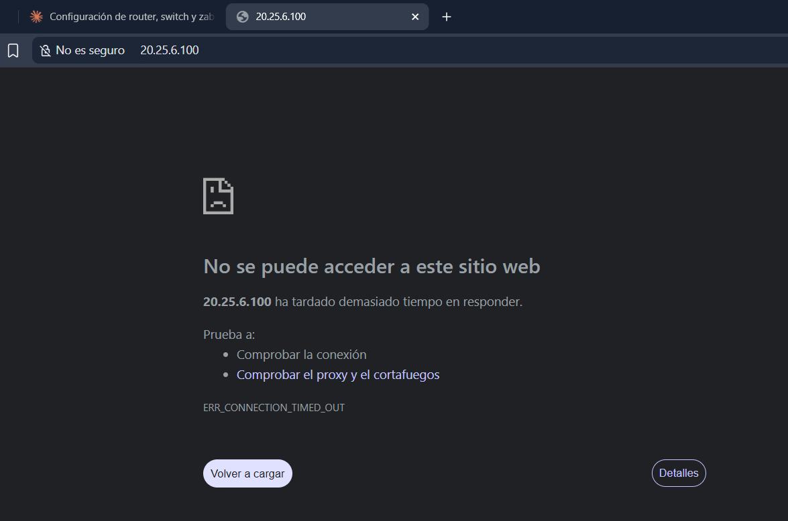

**Qué muestra:** `ERR_CONNECTION_TIMED_OUT` al abrir `20.25.6.100`.
**Causa:** en ese momento el servidor no tenía instalado Zabbix ni Apache (`systemctl` devolvía *Unit could not be found*).
**Solución:** instalar Zabbix con [`01_instalar_zabbix.sh`](../scripts/01_instalar_zabbix.sh).

## 2. Servidor sin internet ni DNS

**Síntomas observados en la terminal:** `ping 8.8.8.8` devolvía *Destination Host Unreachable* desde `20.25.6.97`, y `repo.zabbix.com` no resolvía (*Temporary failure in name resolution*).
**Causa:** la LAN `20.25.6.0/24` estaba aislada; R1 no tenía salida a internet.
**Solución:** conectar un nodo **NAT1** a `Fa0/0` de R1 (visible en la topología de GNS3) y configurar en R1 `ip address dhcp` + `ip nat outside` en `Fa0/0`, `ip nat inside` en `Gi1/0` y `ip nat inside source list 1 interface FastEthernet0/0 overload`. Esa configuración está en [`R1-running-config.txt`](../running-configs/R1-running-config.txt).

> No hay captura del fallo original (se registró solo como texto de terminal); la evidencia de la solución es el running-config de R1 y la topología.

## 3. Error 1045 al importar el esquema

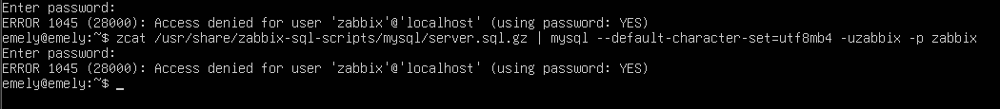

**Qué muestra:** `ERROR 1045 (28000): Access denied for user 'zabbix'@'localhost'` al importar `server.sql.gz`.
**Causa:** la contraseña tecleada no coincidía con la guardada para el usuario `zabbix` de la base de datos (un comando previo se había cortado a medias).
**Solución:** volver a fijarla con `ALTER USER 'zabbix'@'localhost' IDENTIFIED BY '…'` y repetir la importación.

## 4. Dashboard con "servidor Zabbix detenido"

| Antes | Registro del servidor | Después |
|---|---|---|
| 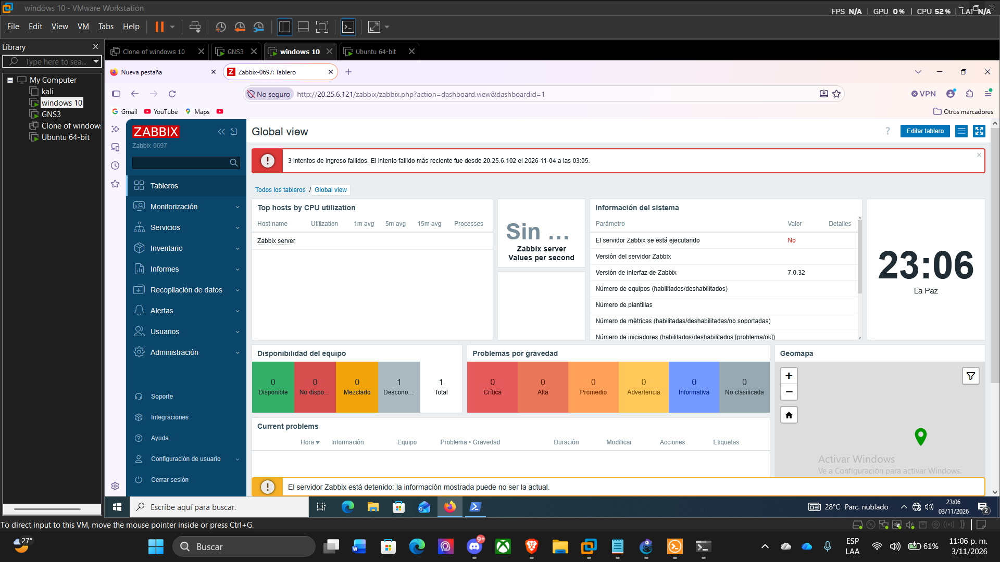 | 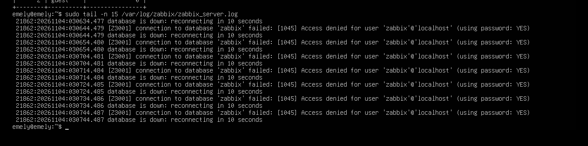 | 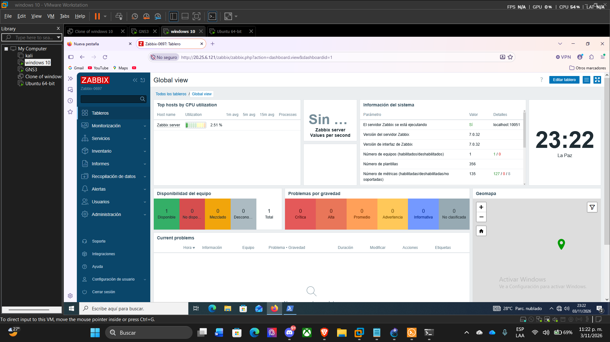 |

**Qué muestran:**
1. Dashboard con *"El servidor Zabbix se está ejecutando: No"* y el aviso *"El servidor Zabbix está detenido"*.
2. `zabbix_server.log` repitiendo `connection to database 'zabbix' failed: [1045] Access denied` cada 10 segundos.
3. Dashboard tras la corrección: *"El servidor Zabbix se está ejecutando: Sí"* (`localhost:10051`).

**Causa:** la web abría (su contraseña era correcta), pero `DBPassword` en `/etc/zabbix/zabbix_server.conf` era distinta, y `systemctl status` mostraba `active (running)` aunque no hubiera conexión a la base.
**Solución:** dejar la **misma contraseña** en la base, en `zabbix_server.conf` y en `/etc/zabbix/web/zabbix.conf.php`, y ejecutar `systemctl restart zabbix-server`. El resultado queda comprobado en la tercera captura; los comandos exactos de la corrección no se capturaron.
**Lección:** `active (running)` no prueba que Zabbix esté conectado; revisar el log y el Dashboard.

## 5. Servidor con dos IPs a la vez

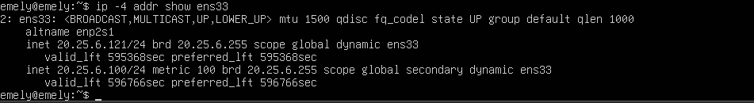

**Qué muestra:** `ens33` con `20.25.6.121/24` y `20.25.6.100/24` (esta última *secondary*), ambas *dynamic*.
**Causa probable:** el cliente DHCP se identificó ante R1 de dos formas (DUID y MAC) y R1 registró dos concesiones. En `r1-dhcp-binding-inicial.png` aparecen `.100` (Client-ID largo tipo DUID) y `.121` (MAC `000c.29b6.b7e5`).
**Solución:** `dhcp-identifier: mac` en el netplan (verificado en la captura final).

## 6. Conflicto de IP `20.25.6.102`

| Binding y conflicto en R1 | Servidor con IP única |
|---|---|
| 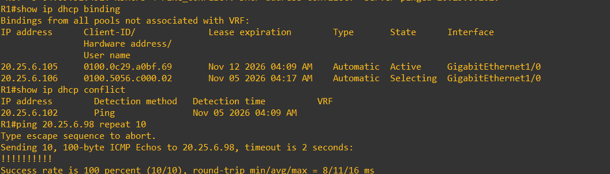 | 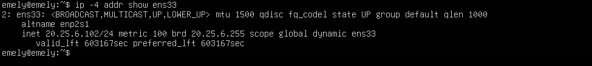 |

**Qué muestran:** `show ip dhcp conflict` con `20.25.6.102` detectada por *Ping*, y `show ip dhcp binding` con otros clientes pero sin el servidor.
**Causa:** tras `clear ip dhcp binding *` en R1, el servidor y otro equipo de la LAN terminaron usando `20.25.6.102`.
**Solución:** liberar y renovar las concesiones, limpiar los conflictos con `clear ip dhcp conflict *` y volver a obtener IP. La captura final (`r1-binding-conflict-pool-final.png`) muestra el binding limpio y `show ip dhcp conflict` vacío.

## 7. `curl` con `https` falla, con `http` responde

| Falla | Responde |
|---|---|
| 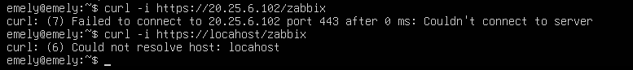 | 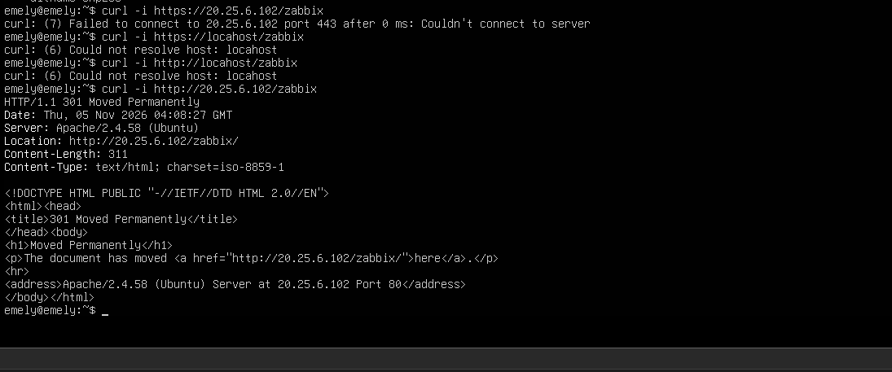 |

**Qué muestran:** `Failed to connect … port 443` (y un `localhost` mal escrito) frente a `HTTP/1.1 301 Moved Permanently` de `Apache/2.4.58 (Ubuntu)`.
**Causa:** Zabbix está publicado solo por HTTP (puerto 80). El `301` es normal: Apache solo agrega la `/` final.
**Solución:** usar `http://IP/zabbix/`.

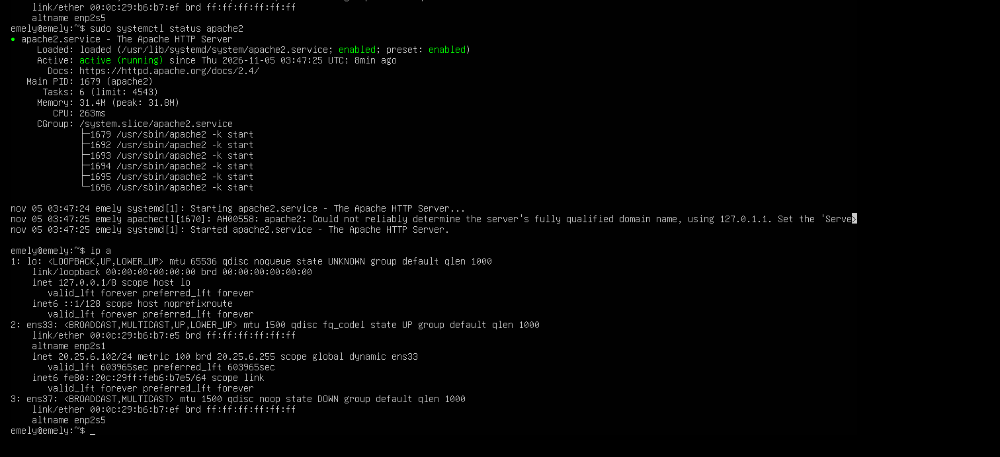

Complemento: `apache2` en `active (running)` y `ens33` con `20.25.6.102/24`.

## 8. `ens33` sin IP tras `ip addr flush`

| Registro de networkd | `networkctl status` | `ip a` |
|---|---|---|
| 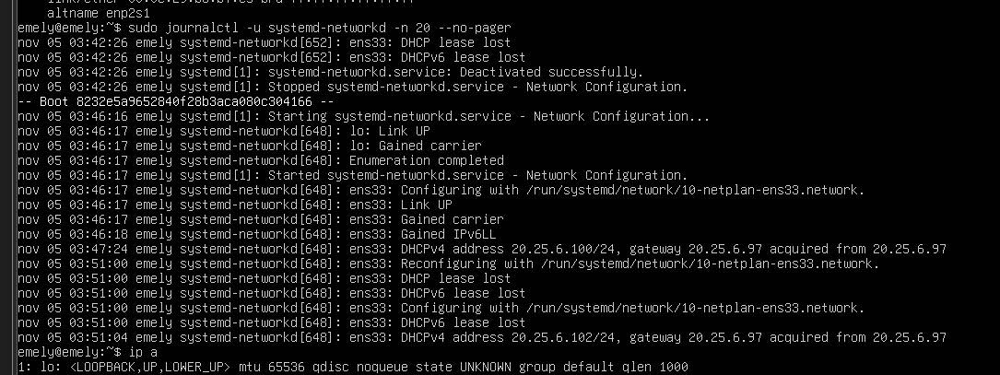 | 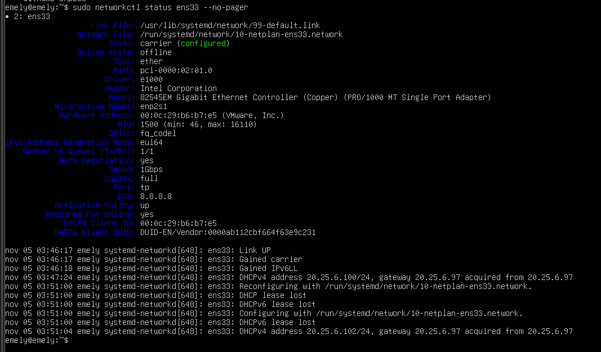 | 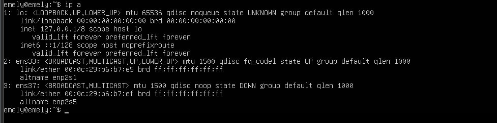 |

**Qué muestran:** el registro con las concesiones `.100` y `.102` obtenidas de `20.25.6.97`; `networkctl` con `carrier (configured)` pero *Online state: offline* y sin línea *Address*; y `ip a` con `ens33` en `UP` y sin ninguna `inet`.
**Causa:** `ip addr flush dev ens33` borra la IP sin que `systemd-networkd` se entere, y este no vuelve a pedirla.
**Solución:** `sudo networkctl reconfigure ens33`. Resultado final en `06-zabbix-cliente-dhcp/ens33-networkctl-netplan-final.png`: IP `20.25.6.108` obtenida por DHCP de `20.25.6.97`.
**Lección:** para forzar una nueva petición DHCP usar `networkctl reconfigure`, no `ip addr flush`.

---

## Observación abierta: nombre `R1.localdomain`

La primera consulta SNMP devolvió `sysName = "R1"` y las posteriores `"R1.localdomain"`. El running-config de R1 **no** contiene `ip domain name`. Una causa posible es un dominio recibido por DHCP en `Fa0/0`, pero **no fue verificado**. No afecta al laboratorio.
